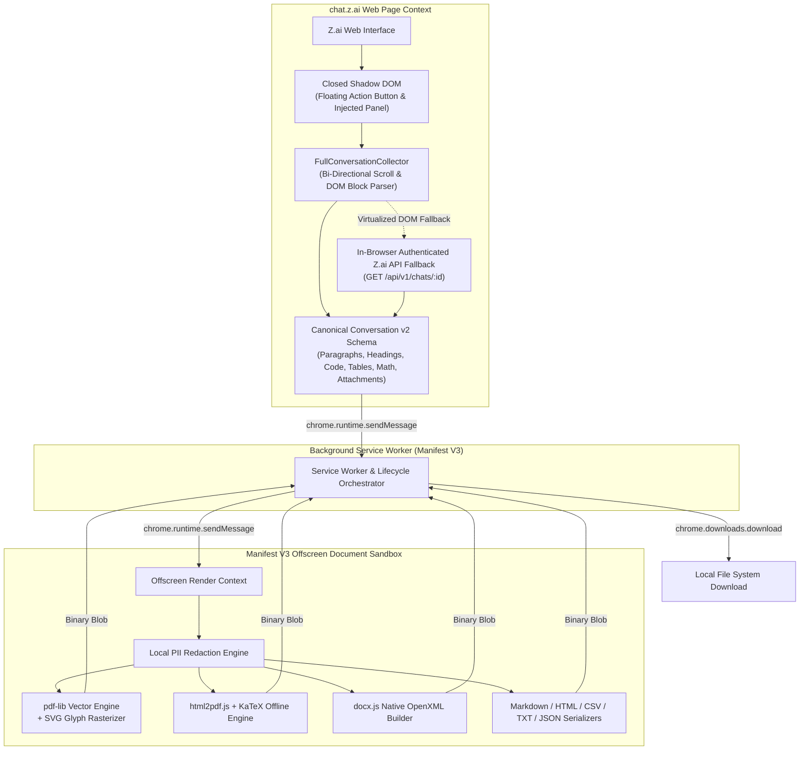

<p align="center">
  
</p>

<p align="center">
  <a href="https://github.com/md-aktaruzzman-emon/Z.ai-Chat-Exporter/releases"></a>
  
  
  
  <a href="./LICENSE"></a>
  
  
</p>

<h3 align="center">
  High-fidelity conversation exporter for <a href="https://chat.z.ai/">Z.ai</a> — export threads to vector PDF, raster PDF, Word (DOCX), Markdown, HTML, JSON, CSV, TXT, and PNG with preserved formatting, zero third-party telemetry, and client-side privacy.
</h3>

<p align="center">
  <a href="#-overview">Overview</a> •
  <a href="#-key-features">Key Features</a> •
  <a href="#-supported-export-formats">Supported Formats</a> •
  <a href="#-installation">Installation</a> •
  <a href="#-usage-guide">Usage Guide</a> •
  <a href="#-technical-architecture">Architecture</a> •
  <a href="#-formatting--content-preservation">Formatting Preservation</a> •
  <a href="#-privacy--security">Privacy & Security</a> •
  <a href="#-development--testing">Development & Testing</a> •
  <a href="#-repository-structure">Repository Structure</a> •
  <a href="#-known-limitations">Known Limitations</a> •
  <a href="#-roadmap">Roadmap</a> •
  <a href="#-contributing">Contributing</a> •
  <a href="#-license">License</a>
</p>

---

## 📖 Overview

Exporting AI conversation transcripts from modern single-page applications often results in severe document degradation:
- **Virtualized DOM Truncation:** Scroll containers discard off-screen messages to preserve browser memory, causing standard scrapers and browser print dialogs to truncate long conversations (>20 messages).
- **Whitespace Collapsing & Overlapping Lines:** Naive PDF generation engines flatten whitespace, miscalculate font bounding boxes, and clip content across page breaks, resulting in overlapping lines or illegible paragraphs.
- **Corrupted Tables & Mathematical Formulas:** LaTeX equations (`$...$`, `\[...\]`) and comparison tables frequently degrade into raw plaintext strings, losing columns and structured notation.
- **Third-Party Data Relays:** Many browser extensions transmit user transcripts to remote cloud services for document compilation, compromising confidential code, business logic, and personal prompts.

**Z.ai Chat Exporter** is an open-source Chrome Extension (Manifest V3) specifically built for **[chat.z.ai](https://chat.z.ai/)**. It incorporates a bi-directional virtualized collector, an in-browser authenticated API fallback, a vector document layout engine with SVG glyph rasterization for Bengali and Unicode scripts, native Word OpenXML packaging, and client-side PII sanitization — executing entirely within your local browser sandbox without third-party servers.

---

## ✨ Key Features

| Capability | Technical Implementation |
|---|---|
| 🔄 **FullConversationCollector** | Bi-directional incremental scroll engine scans and accumulates virtualized DOM nodes before recycling. Pairs with an in-browser authenticated Z.ai API fallback (`/api/v1/chats/:id/messages/batch`) to capture 200+ message threads without data loss. |
| 🛡️ **Deterministic Message Fingerprinting** | Content identity hashing (`role:textLen:startStr:endStr`) prevents duplicate entries and ensures strict chronological ordering. |
| 📄 **Dual PDF Rendering Engines** | **PDF (Vector)** uses `pdf-lib` + `PdfLayoutEngine` with transparent SVG glyph rasterization for complex Indic/Bengali scripts, running headers/footers, and selectable text. **PDF (Raster)** uses `html2pdf.js` with embedded offline KaTeX CSS for pixel-exact visual snapshots. |
| 🎨 **'extrention z' Visual Style** | Distinctive card styling: mint-green user prompt cards (`#f0fdf4` fill, `#86efac` border), white attachment cards with metadata badges (`PDF • 1.4 MB`), and vector running headers/footers with dynamic page numbering (`Page X of Y`). |
| 📝 **Native Word / DOCX Generation** | Builds genuine Microsoft Word OpenXML (`.docx`) files with native heading levels (`Heading 1–3`), zebra-striped tables (`cantSplit` row protection), monospaced code blocks, and formatted callouts. |
| 📐 **Offline KaTeX Formula Rendering** | Renders LaTeX equations offline without external CDN dependencies: high-DPI vector SVG paths for PDF, native Word styling, and self-contained HTML equations. |
| 🇧🇩 **Bengali & Complex Script Support** | Combines standard Latin typography with high-DPI SVG glyph rasterization and coalesced text runs, resolving Bengali and Indic diacritic rendering and conjunct glyph layout. |
| 🧹 **Deep PII Anonymization** | Local regular expression engine redacts email addresses, telephone numbers, API keys (`sk-...`), bearer tokens, and JWT credentials across top-level blocks and inline runs (paragraphs, lists, and tables) before file serialization. |
| 🛡️ **Formula & Navigation Injection Defenses** | Neutralizes spreadsheet formula injection (CWE-1236) in CSV exports with leading quote guards, enforces strict protocol whitelisting (`http:`, `https:`, `mailto:`) on hyperlink navigations, and escapes document titles. |
| 💎 **Glassmorphism UI & 3D Emblem** | Modern popup and options interfaces featuring backdrop blur, vibrant emerald accents, status indicators, and custom 3D metallic emblem iconography. |
| 🔒 **100% Client-Side Processing** | Zero third-party API calls, zero analytics trackers, and zero telemetry. All document compilation, image rendering, and file downloads execute strictly within browser memory. |
| 🌍 **Bilingual Interface** | Full user interface localization in English (`en`) and Bengali (`bn`), configurable in the extension popup and options page. |

---

## 📤 Supported Export Formats

Z.ai Chat Exporter provides 9 dedicated export targets tailored for specific reading, archiving, and analysis workflows:

| Format | Extension | Generation Engine | Primary Use | Formatting Characteristics |
|:---:|:---:|:---:|---|---|
| **PDF (Vector)** | `.pdf` | `pdf-lib` + `PdfLayoutEngine` | Publication, printing & archival | Selectable text, transparent SVG glyph rasterization for Bengali/Unicode, mint user cards, running headers & footers, zero text overlap. |
| **PDF (Raster)** | `.pdf` | `html2pdf.js` + `html2canvas` | Exact visual chat snapshot | Offline KaTeX styling, natural multi-page card pagination, embedded visual charts and attachments. |
| **Word (DOCX)** | `.docx` | `docx` OpenXML Builder | Editing & enterprise reports | Native Word tables with column widths and shaded headers, outline headings (`Heading 1–3`), monospaced code blocks, callouts. |
| **Markdown** | `.md` | Canonical GFM Serializer | Notes, Obsidian & Notion | GitHub Flavored Markdown tables, language-fenced code blocks, blockquotes, and Obsidian callout notation. |
| **HTML** | `.html` | Standalone Inlined Renderer | Offline browser viewing | Self-contained single-file document with bundled KaTeX CSS, responsive tables, and syntax-highlighted code. |
| **JSON** | `.json` | Canonical Model v2 | Automation & LLM training | Complete structured schema containing message timestamps, block trees, role metadata, and token statistics. |
| **CSV** | `.csv` | RFC 4180 Serializer | Spreadsheet analysis & metrics | Tabular format (`index`, `role`, `timestamp`, `text`, `wordCount`, `charCount`, metrics) with UTF-8 BOM for Microsoft Excel. |
| **Plain Text** | `.txt` | Structured Plaintext Serializer | Terminal viewing & CLI tools | Clean, human-readable transcript with ASCII markdown tables, indented list items, attachment tags, and speaker dividers. |
| **PNG (Image)** | `.png` | Multi-Slice `html2canvas` | Social sharing & presentations | High-resolution raster capture. Automatically segments extra-long conversations into sequential numbered image slices. |

---

## ⚙️ Installation

### Option 1: Load from Source (Developer Mode)

> **Prerequisites:** [Node.js](https://nodejs.org/) (v18 or higher) and Google Chrome (or Chromium-based browsers such as Microsoft Edge, Brave, or Opera).

```bash
# 1. Clone the repository
git clone https://github.com/md-aktaruzzman-emon/Z.ai-Chat-Exporter.git
cd Z.ai-Chat-Exporter

# 2. Install dependencies
npm install

# 3. Build the production extension
npm run build
```

The compiled, production-ready extension bundle will be output to the `dist/` directory.

### Option 2: Load into Google Chrome

1. Open Chrome and navigate to `chrome://extensions/`.
2. Enable the **Developer mode** toggle in the top-right corner.
3. Click the **Load unpacked** button in the top-left toolbar.
4. Select the **`dist/`** directory located inside the project folder.
5. Confirm that **Z.ai Chat Exporter** appears in your extension list with version `2.1.0`.

---

## 🚀 Usage Guide

1. Navigate to **[chat.z.ai](https://chat.z.ai/)** and sign in to your account.
2. Open any conversation thread containing text, code, math, or tables.
3. Access the exporter using any of these methods:
   - Click the **floating action button** in the bottom-right corner of the chat window.
   - Click the extension icon in your Chrome toolbar.
   - Press the default keyboard shortcut: **`Alt + Shift + E`**.
4. Configure your export preferences:
   - **Format Selection:** Choose from PDF (Vector), PDF (Raster), DOCX, Markdown, HTML, JSON, CSV, TXT, or PNG.
   - **Filename Template:** Customize output naming using tokens such as `{{title}}`, `{{date}}`, `{{time}}`, and `{{model}}`.
   - **PII Anonymization:** Toggle redaction to mask personal email addresses, phone numbers, and API tokens.
   - **Theme & Layout:** Select Light, Dark, or System theme.
5. Click **Export Conversation**. The extension collects the conversation, compiles the document in the offscreen sandbox, and triggers a browser download prompt.

---

## 🏗️ Technical Architecture

The extension is designed around the **Chrome Manifest V3** architecture, enforcing strict isolation between the host web page, the extension orchestration layer, and the document compilation sandbox:



### Component Responsibilities

1. **Content Script (`src/content/index.js`, `scraper.js`, `dom-engine.js`):** Injected into `chat.z.ai`. Renders a non-intrusive UI via closed Shadow DOM. Scrapes DOM nodes into structured semantic blocks. If DOM virtualization truncates historical messages, it queries Z.ai's authenticated endpoints (`/api/v1/chats/:id/messages/batch`) directly using the user's active session.
2. **Canonical Conversation Model (`src/core/conversation-model.js`):** Intermediate representation normalizing headings, paragraphs, lists, code blocks, tables, math formulas, thinking blocks, and attachments into a unified abstract syntax tree (AST).
3. **Background Service Worker (`src/background/service-worker.js`):** Manages extension lifecycle, coordinates messages between content scripts and the offscreen document, and initiates downloads via `chrome.downloads`.
4. **Offscreen Document (`src/offscreen/offscreen.js`):** Headless sandbox providing full DOM APIs (canvas, window, DOMParser) in Manifest V3 for resource-intensive PDF rendering, DOCX compilation, and image slicing without freezing the active tab.

---

## 📐 Formatting & Content Preservation

| Content Type | Preservation Technique |
|---|---|
| **Paragraphs & Linebreaks** | Preserves multiline breaks and blank lines within speech turns without flattening separate thoughts into a single wall of text. |
| **Headings (H1–H6)** | Preserves semantic level hierarchy. Rendered with proportional font sizes, leading, and outline levels in DOCX. |
| **Ordered & Bulleted Lists** | Parsed into structured list item arrays with depth levels, numbers, and bullets. Preserves nested sub-lists in PDF, DOCX, Markdown, and TXT. |
| **Code Blocks** | Retains original programming language, blank lines, and monospace indentation. Styled with dark syntax backgrounds and light monospaced text. |
| **Tables & Grids** | Reconstructed as true multi-cell tables with header shading and border separation in PDF, DOCX, HTML, Markdown, and TXT. |
| **Mathematical Formulas** | LaTeX formulas (`$...$`, `$$...$$`) rendered via local KaTeX into vector SVG paths in PDF, OMML in DOCX, and formatted HTML without remote CDN calls. |
| **Bengali & Complex Scripts** | Coalesced SVG glyph rasterization dynamically paints Bengali and Indic conjunct characters in vector PDFs with clean baselines and zero character overlapping. |
| **Thinking / Reasoning Blocks** | Detected from `<details>` and reasoning containers; rendered with distinctive italic callout styling and subtle left accent borders. |
| **File Attachments & Dividers** | Rendered with file type icons, name, and size badges (`[Attachment: file.pdf (1.2 MB)]`). Horizontal rules rendered as clean section dividers. |

---

## 🔒 Privacy & Security

Z.ai Chat Exporter adheres strictly to client-side data security principles:

- **Zero Third-Party Network Calls:** The extension contains no analytics SDKs, telemetry beacons, crash reporters, or external tracking pixels. Your conversation content, prompts, and code are never transmitted to any third-party server.
- **In-Browser Z.ai Communication:** When the authenticated API fallback is activated for virtualized threads, requests are made directly between your browser and `chat.z.ai` using your existing session cookies. No third-party proxy is involved.
- **Minimal Manifest Permissions:**
  - `activeTab`: Interacts only with the currently active Z.ai tab when triggered.
  - `downloads`: Saves the generated export files to your local storage.
  - `storage`: Retains user configuration (theme, export format, custom filename template, local history) in `chrome.storage.local` and `chrome.storage.sync`.
  - `offscreen`: Executes the document compilation engines in a secure offscreen sandbox as mandated by Chrome Manifest V3.
  - `contextMenus` *(optional)*: Requested only on demand if the user enables the context menu shortcut in Settings.
  - `host_permissions`: Strictly constrained to `https://chat.z.ai/*`, `https://z.ai/*`, and `https://*.z.ai/*`.
- **Strict Content Security Policy (CSP):** Configured as `"script-src 'self'; object-src 'self'"`, prohibiting remote code execution. KaTeX and all math assets execute locally with zero external network access.
- **HTML & URL Sanitization:** Incoming markup is sanitized using DOMPurify before parsing. Hyperlink URLs (`<a href>`) are strictly validated against `javascript:`, `vbscript:`, and `data:` navigation attacks, control characters are stripped, and document titles are escaped to prevent tag breakout.
- **Spreadsheet Formula Neutralization:** Cells beginning with formula trigger characters (`=`, `+`, `-`, `@`, `\t`, `\r`) are automatically escaped with leading single quotes (`'`) in CSV exports to neutralize formula injection (CWE-1236).

---

## 🧪 Development & Testing

The project maintains an automated test suite powered by [Vitest](https://vitest.dev/) to verify scraper heuristics, layout measurement, Unicode rendering, and multi-format exporters.

```bash
# Run complete test suite (82 tests)
npm test

# Run tests in interactive watch mode
npm run test:watch

# Start Vite dev server with extension hot-reloading
npm run dev

# Run static analysis and linting checks
npm run lint

# Verify code formatting with Prettier
npm run format:check

# Auto-format codebase using Prettier
npm run format

# Re-generate extension icon assets
npm run generate-icons

# Compile production extension into dist/
npm run build
```

### Verified Test Suite Results

```text
 ✓ tests/formatting-quality.test.js  (13 tests)
 ✓ tests/rich-exporters.test.js      (22 tests)
 ✓ tests/exporters.test.js           (33 tests)
 ✓ tests/structural-scraper.test.js  (14 tests)

 Test Files  4 passed (4)
      Tests  82 passed (82)
   Duration  2.95s
```

### Verified Capabilities in Test Suite
- **Whitespace Preservation:** Multiline breaks, blank lines, and semantic paragraph boundaries are verified across all formats without flattening.
- **Virtualization Collector:** Incremental bi-directional scrolling tested on synthetic 200-message virtualized containers.
- **Complex Script Rendering:** Bengali, Hindi, Arabic, and emoji glyph rendering validated with zero coordinate collision.
- **Table Layout & Wrapping:** Automatic column width calculation and text wrapping tested up to 23 comparison tables per session.
- **Real-World Fixture Test:** End-to-end verified on [`zai_export_2026-10-03.json`](./tests/fixtures/rich-conversation.js) (20 messages, 10,200 words, 63,897 characters, 5 code blocks, 23 tables) producing a 54-page vector PDF, native DOCX, Markdown, and tabular CSV cleanly.

---

## 📁 Repository Structure

```
Z.ai-Chat-Exporter/
├── assets/                         # Documentation assets
│   ├── banner.gif                  # 3D animated GitHub banner (1280x400)
│   └── banner.png                  # High-resolution static fallback banner
├── scripts/                        # Build & utility scripts
│   ├── generate-icons.cjs          # Extension icon generation utility
│   ├── generate-samples.js         # Test fixture generator
│   ├── generate_animated_banner.py # 3D animated banner generator (PIL + FFmpeg)
│   └── process-logo.ps1            # Logo processing script
├── src/                            # Extension source code
│   ├── assets/icons/               # Runtime extension icons (16, 32, 48, 128px)
│   ├── background/
│   │   └── service-worker.js       # Manifest V3 service worker & message router
│   ├── content/
│   │   ├── dom-engine.js           # Chat container locator & DOM observer
│   │   ├── scraper.js              # FullConversationCollector & DOM block parser
│   │   ├── index.js                # Content script initialization & event listeners
│   │   └── ui/                     # Closed Shadow DOM UI (panel, floating button)
│   ├── core/
│   │   ├── conversation-model.js   # Canonical Conversation v2 schema & inline runs
│   │   ├── math-renderer.js        # Offline KaTeX parser (SVG / MathML / OMML)
│   │   ├── table-layout.js         # Dynamic table cell measurement & column fitting
│   │   ├── katex-css.js            # Inlined KaTeX stylesheet
│   │   ├── pii.js                  # Regular expression PII redaction engine
│   │   ├── sanitize.js             # DOMPurify HTML sanitization wrapper
│   │   └── utils/                  # Download, filename, i18n, and image helpers
│   ├── exporters/
│   │   ├── pdf-vector.js           # Vector PDF generator with SVG glyph rasterization
│   │   ├── pdf-raster.js           # html2pdf.js visual snapshot exporter
│   │   ├── docx.js                 # Native Microsoft Word document builder
│   │   ├── markdown.js             # GFM / Obsidian / Notion markdown generator
│   │   ├── html.js                 # Standalone self-contained HTML exporter
│   │   ├── json.js                 # Canonical conversation JSON serializer
│   │   ├── csv.js                  # RFC 4180 compliant CSV generator with UTF-8 BOM
│   │   ├── txt.js                  # Structured plain text transcript exporter
│   │   └── png.js                  # Multi-slice raster image exporter
│   ├── offscreen/                  # Manifest V3 offscreen document sandbox
│   │   ├── offscreen.html
│   │   └── offscreen.js
│   ├── options/                    # Options & Settings configuration page
│   └── popup/                      # Toolbar action popup interface
├── tests/                          # Automated Vitest test suite
│   ├── fixtures/                   # Test fixtures (rich-conversation, html snippets)
│   ├── exporters.test.js           # Unit tests for all exporters
│   ├── formatting-quality.test.js  # Whitespace, Bengali, table & ghost turn tests
│   ├── rich-exporters.test.js      # Virtualization collector & KaTeX tests
│   └── structural-scraper.test.js  # DOM parsing & block recursion tests
├── manifest.json                   # Chrome Extension Manifest V3 configuration
├── package.json                    # Project dependencies, scripts & metadata
├── vite.config.js                  # Vite bundler configuration with CRX plugin
└── LICENSE                         # MIT License
```

---

## ⚠️ Known Limitations

| Limitation | Technical Context & Recommended Workaround |
|---|---|
| **Wide Tables (>8 Columns) in Portrait PDF** | A4 portrait pages have a printable width of 190mm (~538pt). Tables with more than 8 dense columns will reduce font size down to 7.5pt. For large data tables, exporting to **Word (DOCX)**, **Markdown**, or **CSV** provides optimal readability. |
| **Cross-Origin External Images** | Images hosted on external third-party domains lacking permissive CORS headers cannot be rasterized onto HTML5 canvas due to browser security restrictions. Same-origin and inline `data:` URI images embed normally. |
| **Tab Throttling on Long Chats** | When exporting very long threads (200+ messages) using DOM scrolling, keep the Z.ai browser tab active and focused. Chromium suspends animation timers and DOM scroll events on background tabs. |
| **WebGL / Tainted Visualizations** | Interactive WebGL canvases with hardware-accelerated shaders cannot be captured via `toDataURL()`. The scraper falls back to capturing the container's accessible text or `aria-label`. |

---

## 🗺️ Roadmap

- [x] Dual PDF engines (Selectable Vector PDF + KaTeX Raster PDF).
- [x] Native OpenXML Word (`.docx`) with styled tables and outline headings.
- [x] Bi-directional virtualized DOM collector with authenticated Z.ai API fallback.
- [x] Transparent SVG glyph rasterization for Bengali and Indic complex scripts.
- [x] Prettier and ESLint integration with 82 automated Vitest unit & regression tests.
- [x] Glassmorphism UI redesign with modern aesthetics and custom 3D metallic emblem iconography.
- [x] Comprehensive security hardening (CWE-1236 CSV formula defense, safe URL scheme whitelist, deep inline run PII redaction).
- [ ] Direct export to cloud storage providers (Google Drive, Dropbox, OneDrive) via user OAuth tokens.
- [ ] Custom PDF themes and font family selection (Noto Serif, Roboto, JetBrains Mono) in Settings.
- [ ] Export directly to Notion database via Notion API integration.
- [ ] Batch conversation export from the Z.ai sidebar conversation list.

---

## 🤝 Contributing

Contributions, bug reports, and enhancements are welcome!

1. Fork the repository.
2. Create a feature branch: `git checkout -b feature/your-feature-name`.
3. Verify that all tests, linting, and formatting checks pass:
   ```bash
   npm test
   npm run lint
   npm run format:check
   ```
4. Commit your changes: `git commit -m "feat: clear description of feature"`.
5. Push to your branch: `git push origin feature/your-feature-name`.
6. Open a Pull Request detailing the changes and verification steps.

---

## 📄 License

This project is licensed under the [MIT License](./LICENSE).

```
MIT License
Copyright (c) 2026 Md. Aktaruzzman Emon
```

<p align="center">
  <sub>Disclaimer: Z.ai Chat Exporter is an independent open-source tool and is not affiliated with, endorsed by, or sponsored by Z.ai or Zhipu AI.</sub>
</p>